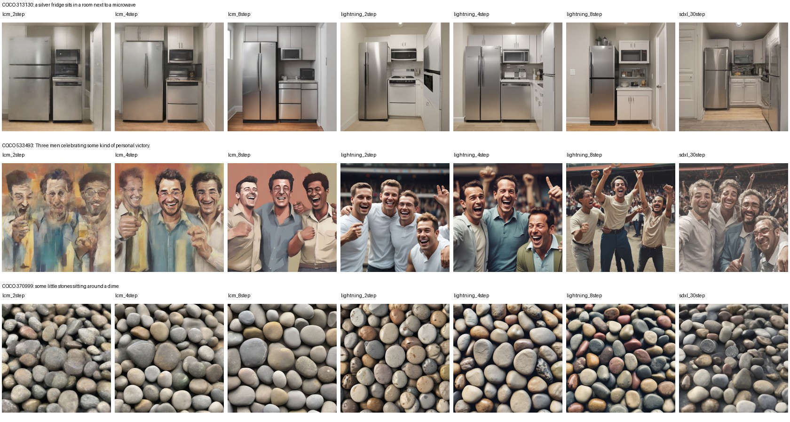
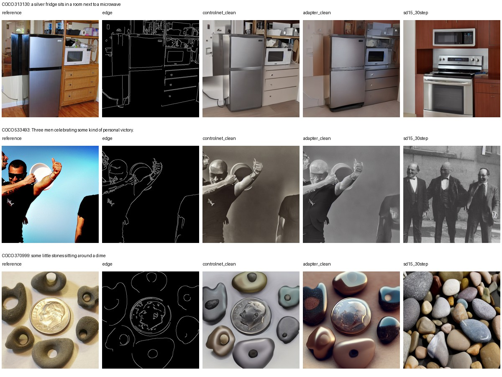

# 本机实验结果与交接状态

## Material Passport

- Origin Skill: academic-research-suite / experiment-agent
- Origin Mode: run
- Origin Date: 2026-10-15T17:06:37.856444+00:00
- Verification Status: UNVERIFIED（未做全量重新生成复现；本机实际输出的文件完整性验收见 results/verification.json）
- Version Label: local-coco-new-v1

## 数据与实验范围

子集：`coco-val2017-new-seed2026-v1`；20张开发、100张测试；每张测试图两个种子。原始报告子集未找回，本次重新抽取，全部方法共享本次固定ID和captions。
清单SHA256：`c80448b54398c85edfba31eefbae477f0cb7380bc5d79e18e7cdcf0e4b49eab9`。完整ID、文本、种子与原图路径见 `data/manifest.json`。
设备：NVIDIA GeForce RTX 5060 Ti；CPU：AMD Ryzen 7 7700 8-Core Processor；PyTorch 2.7.0+cu128，CUDA runtime 12.8。完整版本锁见requirements-lock.txt。
生成阶段记录耗时：2.96小时，含模型加载、预热和图像保存；与表中排除这些开销的单次Latency口径不同。

详细协议、指标公式、运行/续跑和交接方式见 [README.md](README.md)。以下数字只来自本次结果文件，不使用历史报告数字填空。

## 已测试指标与进度

| 配置 | 正式图像/200 | 已计算指标 |
|---|---:|---|
| lcm_4step | 200 | KID、CLIPScore、Latency、Throughput、Peak VRAM |
| lcm_2step | 200 | KID、CLIPScore、Latency、Throughput、Peak VRAM |
| lcm_8step | 200 | KID、CLIPScore、Latency、Throughput、Peak VRAM |
| lightning_4step | 200 | KID、CLIPScore、Latency、Throughput、Peak VRAM |
| lightning_2step | 200 | KID、CLIPScore、Latency、Throughput、Peak VRAM |
| lightning_8step | 200 | KID、CLIPScore、Latency、Throughput、Peak VRAM |
| sdxl_30step | 200 | KID、CLIPScore、Latency、Throughput、Peak VRAM |
| controlnet_clean | 200 | KID、CLIPScore、Latency、Throughput、Peak VRAM、Edge F1、保留边缘召回率、边缘距离 |
| controlnet_erase25 | 200 | KID、CLIPScore、Latency、Throughput、Peak VRAM、Edge F1、保留边缘召回率、边缘距离 |
| controlnet_erase50 | 200 | KID、CLIPScore、Latency、Throughput、Peak VRAM、Edge F1、保留边缘召回率、边缘距离 |
| controlnet_sparse | 200 | KID、CLIPScore、Latency、Throughput、Peak VRAM、Edge F1、保留边缘召回率、边缘距离 |
| controlnet_dense | 200 | KID、CLIPScore、Latency、Throughput、Peak VRAM、Edge F1、保留边缘召回率、边缘距离 |
| adapter_clean | 200 | KID、CLIPScore、Latency、Throughput、Peak VRAM、Edge F1、保留边缘召回率、边缘距离 |
| adapter_erase25 | 200 | KID、CLIPScore、Latency、Throughput、Peak VRAM、Edge F1、保留边缘召回率、边缘距离 |
| adapter_erase50 | 200 | KID、CLIPScore、Latency、Throughput、Peak VRAM、Edge F1、保留边缘召回率、边缘距离 |
| adapter_sparse | 200 | KID、CLIPScore、Latency、Throughput、Peak VRAM、Edge F1、保留边缘召回率、边缘距离 |
| adapter_dense | 200 | KID、CLIPScore、Latency、Throughput、Peak VRAM、Edge F1、保留边缘召回率、边缘距离 |
| sd15_30step | 200 | KID、CLIPScore、Latency、Throughput、Peak VRAM、Edge F1、保留边缘召回率、边缘距离 |

正式输出：**3600/3600**；完成指标汇总：**18/18**；状态：**已完成生成与自动评测**。

## 自动指标结果

KID为原始单位，无偏估计可能为负，保留负值而不截断；先分别计算两个生成种子，再取均值；CLIPScore按图像平均。峰值显存为200次调用的最大allocated值。吞吐量为排除外部I/O的batch=1串行值。

| 配置 | KID ↓ | CLIPScore ↑ | 平均延迟 s ↓ | 吞吐 张/s ↑ | 峰值 MiB ↓ |
|---|---:|---:|---:|---:|---:|
| lcm_4step | 0.000739 | 31.468 | 1.8392 | 0.5437 | 9948.8 |
| lcm_2step | 0.003695 | 31.339 | 1.4479 | 0.6907 | 9948.8 |
| lcm_8step | 0.002228 | 31.353 | 2.6040 | 0.3840 | 9948.8 |
| lightning_4step | 0.001354 | 31.096 | 1.8278 | 0.5471 | 9950.8 |
| lightning_2step | 0.001944 | 31.073 | 1.4453 | 0.6919 | 9950.8 |
| lightning_8step | 0.000403 | 30.841 | 2.5914 | 0.3859 | 9950.8 |
| sdxl_30step | -0.001012 | 31.289 | 11.7619 | 0.0850 | 9948.0 |
| controlnet_clean | 0.004078 | 30.042 | 2.7403 | 0.3649 | 3410.2 |
| controlnet_erase25 | 0.000989 | 30.240 | 2.7394 | 0.3650 | 3410.2 |
| controlnet_erase50 | 0.000486 | 30.338 | 2.7354 | 0.3656 | 3410.2 |
| controlnet_sparse | 0.003286 | 30.109 | 2.7368 | 0.3654 | 3410.2 |
| controlnet_dense | 0.004610 | 29.962 | 2.7340 | 0.3658 | 3410.2 |
| adapter_clean | 0.007647 | 28.917 | 1.9918 | 0.5021 | 2835.4 |
| adapter_erase25 | 0.009590 | 28.446 | 1.9894 | 0.5027 | 2835.4 |
| adapter_erase50 | 0.009841 | 27.841 | 1.9890 | 0.5028 | 2835.4 |
| adapter_sparse | 0.006488 | 29.069 | 1.9893 | 0.5027 | 2835.4 |
| adapter_dense | 0.006400 | 28.760 | 1.9887 | 0.5028 | 2835.4 |
| sd15_30step | -0.000634 | 31.151 | 1.9836 | 0.5041 | 2675.1 |

## 旧方法结构指标

| 配置 | Edge F1 ↑ | 保留边缘召回率 ↑ | 边缘距离 ↓ |
|---|---:|---:|---:|
| controlnet_clean | 0.8355 | 0.8026 | 0.004466 |
| controlnet_erase25 | 0.7026 | 0.7955 | 0.008175 |
| controlnet_erase50 | 0.5458 | 0.7781 | 0.013810 |
| controlnet_sparse | 0.6750 | 0.8151 | 0.009013 |
| controlnet_dense | 0.7124 | 0.7484 | 0.006058 |
| adapter_clean | 0.5887 | 0.5229 | 0.012375 |
| adapter_erase25 | 0.4940 | 0.5399 | 0.018515 |
| adapter_erase50 | 0.3822 | 0.5512 | 0.029721 |
| adapter_sparse | 0.4661 | 0.5259 | 0.018106 |
| adapter_dense | 0.6136 | 0.4880 | 0.009264 |
| sd15_30step | 0.1854 | 0.2068 | 0.032287 |

## 解释与未执行项目

- 1024²的SDXL纯文本组与512²的SD1.5边缘控制组分别分析，不能用跨组排名声称某加速算法因果优于另一种控制架构。
- KID每种子100张，100次50张子集的标准差是子集波动，不是置信区间；小样本结论需谨慎。完整逐图分数、CLIP/边缘bootstrap区间、各种子KID见results/metrics。
- 当前不包含真实人工评分；没有伪造或根据模型自动推断人工评分。
- 历史报告的强度扫描、尺度消融、控制时段消融没有在本次重跑，不能标记为本机已复现。
- 原图中心裁剪可能裁掉caption对象；本次没有逐图人工语义筛查。
- 模型版本固定；CUDA跨硬件/版本不保证逐像素一致。
- 各检查点预训练数据不同，本次不能保证COCO验证图像从未出现在模型预训练数据中。

## 交给下一位同学

1. 先读README.md和本报告，检查results/verification.json的状态。
2. 使用data/manifest.json，不重新随机划分；原图、参考图、边缘条件均已包含。
3. 建立新环境并安装requirements-lock.txt；运行scripts/download_models.py下载固定revision权重，再运行scripts/verify_models.py核验。
4. run_experiments.py自动跳过配置与哈希均有效的已完成项；evaluate.py复用特征缓存；最后build_report.py重新汇总。
5. 续跑保护会检查硬件和依赖版本；换机器或环境测量必须使用独立实验目录，避免混入本次效率统计。新增实验请保留旧结果。人工评价和旧消融属于后续任务。

## 验证记录

- results/verification.json：3600张输出、18组指标、数据清单与处理结果、配置和SHA256完整性验收通过；没有全量重新生成第二遍。
- results/model_verification.json：固定revision模型权重的官方LFS SHA256核验通过。
- 协议测试5项、运行环境保护测试3项、续跑保护集成测试1项通过；完整配置跳过测试通过。
- results/metric_consistency.json：缓存特征上的LCM 4步种子0 KID与TorchMetrics实现一致，最大绝对差约4.34e-19；此项是公式与聚合一致性核对。
- results/handoff_code_verification.json：交接代码与实际执行源码的四个核心函数AST一致；新增部分是续跑环境保护。

## 固定样本预览

按冻结测试序列前3张、种子索引0展示，没有按结果筛选。SDXL组只接收文本；SD1.5控制方法额外接收边缘。预览不代替总体指标或人工评价。

