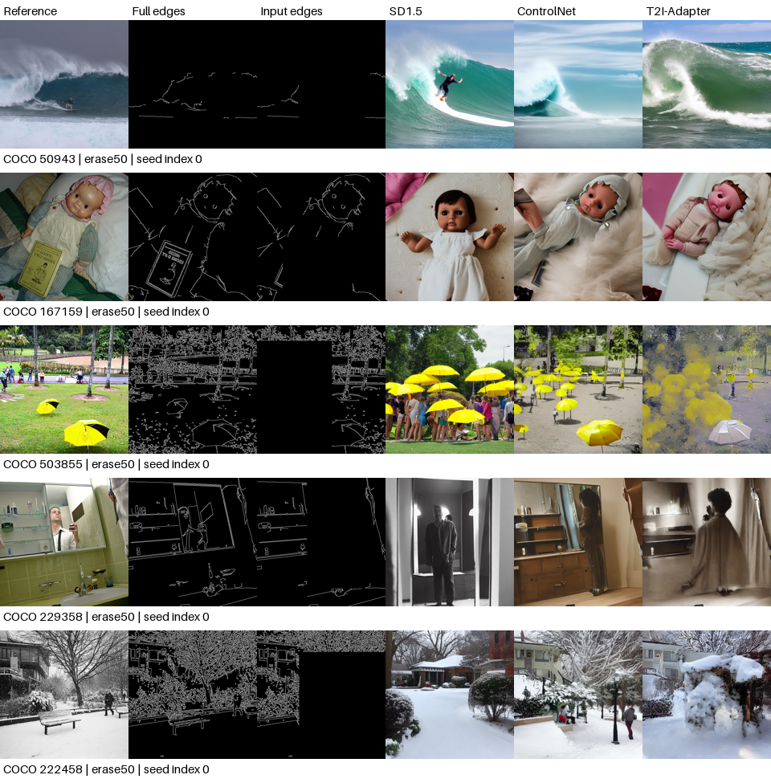

# 补充图像检查备注

这些是执行助手对实际生成图像的定性观察，不是三名真实评价者的评分。

样本按 Adapter 的 erase50 图像级参考 F1 的0、25、50、75、100分位数选择；指标先平均两个种子，图像展示固定种子0。

## COCO 50943

This person is riding a big wave on the water.

参考F1：ControlNet 0.4258；Adapter 0.0528。

参考边缘稀疏，擦除后仅残留少量曲线。两种条件方法均改变浪峰和人物的布局；低参考结构分数不等同于海浪画面完全不自然。

## COCO 167159

A baby doll laying on top of a bed under a book.

参考F1：ControlNet 0.4920；Adapter 0.3062。

擦除的小册/卡片区域没有恢复为参考中的同一物体，娃娃身体和被褥形状也有变化。需区分输入遵循与参考结构复原。

## COCO 503855

A park with yellow umbrellas on the grass and onlookers in the background.

参考F1：ControlNet 0.6824；Adapter 0.4164。

输出出现额外的黄色伞状形体；Adapter画面还有明显块状和模糊纹理。此例说明边缘指标不能替代自然度检查。

## COCO 229358

A man standing in front of a mirror in a room.

参考F1：ControlNet 0.5936；Adapter 0.4756。

缺损后两方法重建了不同的人物轮廓和浴室物件，保留的柜体线条提供了主要空间约束。

## COCO 222458

Entire front yard is filled with snow while people walk around.

参考F1：ControlNet 0.7535；Adapter 0.6194。

保留的树枝和建筑密集边缘支持较高结构分数，但人物位置与雪景局部形状仍有改变。