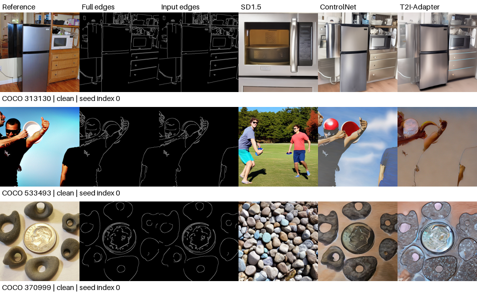
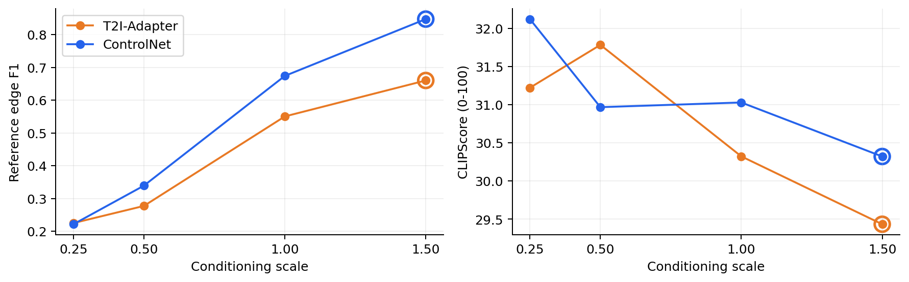
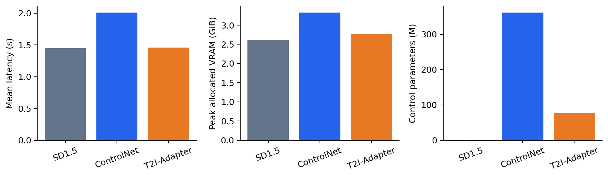
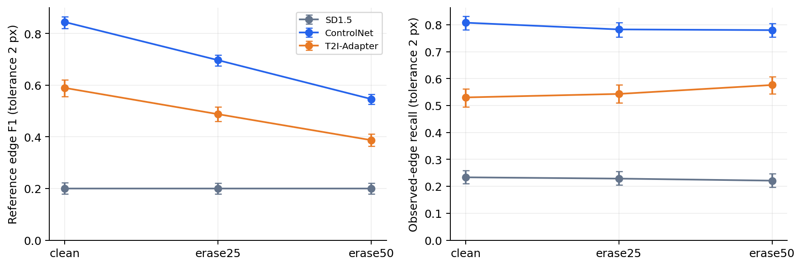
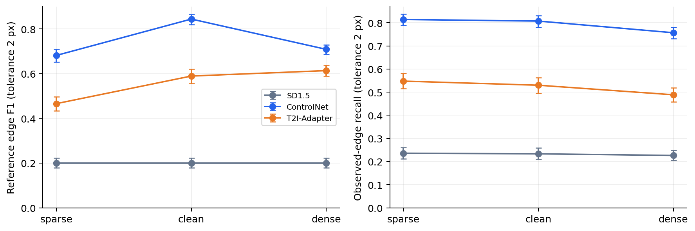
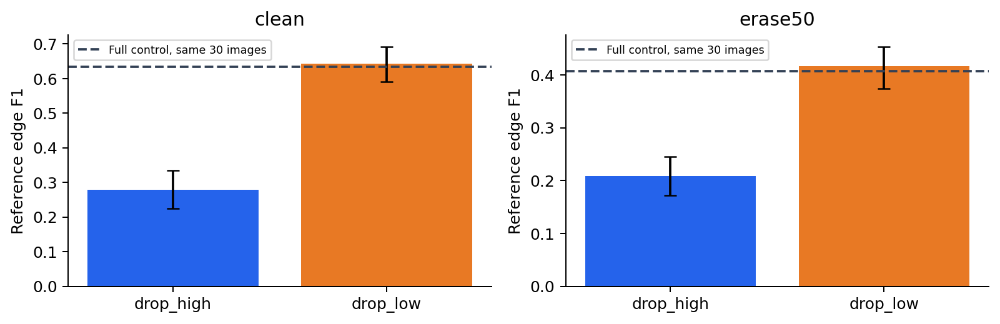
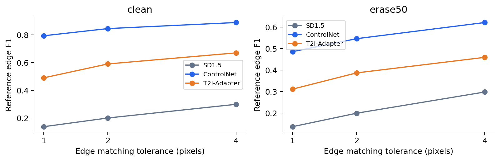
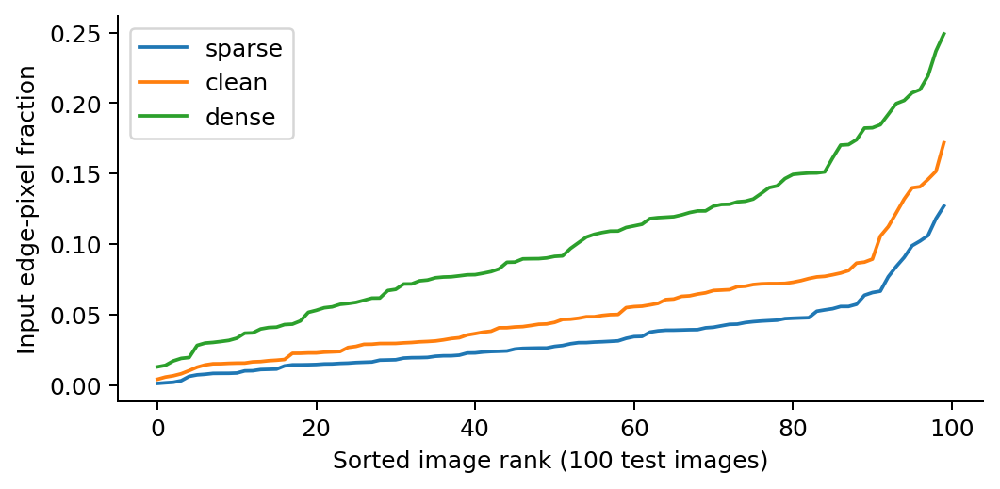
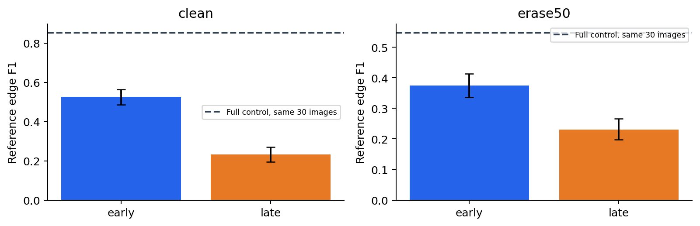
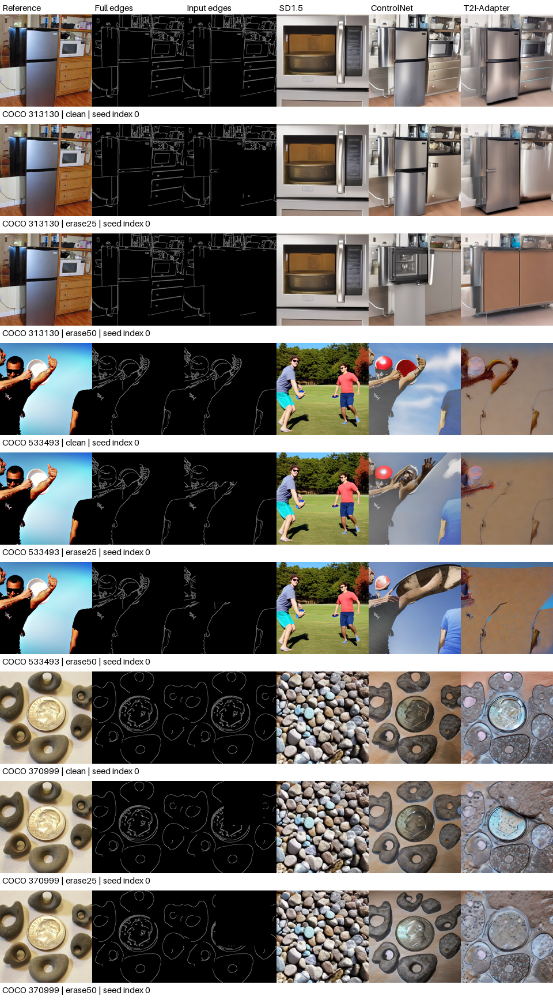

# 不完整边缘条件下可控图像生成的效率与鲁棒性研究

ControlNet 与 T2I-Adapter 的预训练系统比较

所有数值由本项目实测；人工评价待真实评分。

## 1. 摘要与研究问题

本项目研究不完整边缘条件下的可控图像生成，在同一 Stable Diffusion 1.5 基础模型上比较 ControlNet Canny、T2I-Adapter Canny 与纯文本生成基线。所有结果来自本设备实际推理，没有新增模型训练。

完成开发集20张、测试集100张，核心与扩展共 2,840 张生成。完整条件下参考 Edge F1：ControlNet 为 0.8448，Adapter 为 0.5897，无控制基线为 0.1997。

固定30步配置下，Adapter 相对 ControlNet 的平均延迟变化为 -27.3%，峰值分配显存变化为 -16.8%。这些是整套预训练系统的实测差异，不是孤立架构的因果效应。

研究问题包括：结构控制与资源开销如何权衡；缺损与密度变化分别造成什么影响；不同尺度条件特征及控制时段的作用是什么。人工视觉偏好尚待真实评价，自动指标不能替代该结论。

## 2. 技术综述与实现

潜空间扩散模型在压缩的 VAE 表示中进行去噪，通过文本编码器提供语义条件，最后解码为图像[1]。本项目冻结基础模型，所有系统共享文本编码器、VAE、U-Net 权重及 DDIM 配置[4]。

ControlNet 使用额外条件分支及零初始化连接向预训练扩散网络注入空间控制信息[2]。在本实验实现中，该分支每个去噪步计算一次，完整生成共30次。

T2I-Adapter 从边缘图提取多尺度条件特征，并将其注入 U-Net 对应层[3]。本实现每张生成只提取一次 Adapter 特征，在30步中复用。参数量较小或特征复用并不意味着整个生成系统按同比例加速。

本次检查点分别为 lllyasviel/control_v11p_sd15_canny 与 TencentARC/t2iadapter_canny_sd15v2。后者配置明确要求单通道输入；ControlNet 使用同一边缘内容的RGB复制。

开发阶段检查条件及强度变化确实改变输出，并验证修改后的完整控制路径与原始路径最终潜变量完全一致。提前退出分支在不启用的步骤不调用 ControlNet，U-Net 仍执行全部30步。

## 3. 数据与实验协议

数据来自 COCO 2017 validation subset[7]。按种子2026生成候选序列，每张图像固定一条原始 caption；开发与测试按图像ID互斥。RGB图像按短边缩放至512并中心裁剪，生成前由执行助手逐图核查 caption 与可见对象；4张因关键对象或动作被裁去而按候选顺序替补，原因保留在清单中。此检查不属于待进行的三人匿名评价。

完整参考边缘使用灰度、3×3 Gaussian（σ=1）、Canny 100/200、apertureSize=3、L2gradient=True。稀疏与密集条件分别为150/250和50/100。评测始终使用完整参考和100/200设置。

同一随机中心与长宽比构造嵌套矩形，目标删除25%与50%的边缘像素。测试集实际平均删除比例为 24.994% 与 49.990%。模型只接收 caption 与当前边缘，不接收原图潜变量或缺损掩码。

所有系统使用512×512、FP16、DDIM 30步、eta=0、CFG=7.5、空负提示、batch size 1与PyTorch SDPA。同一图像的两个噪声张量在方法和条件间复用。开发扫描最终选择 ControlNet 强度 1.5、Adapter 强度 1.5。

选择规则为：保留 CLIPScore 不低于各方法强度1配置超过1分的候选，然后选择参考F1最高者，同分取较小强度。强度在正式测试及消融中固定。

统计单位为原始图像，先平均两个生成种子，再按图像进行5000次成对 bootstrap。重复计时与多位评价者评分不作为新的独立图像样本。

## 4. 完整条件比较与效率

设备为 RTX 3090 24 GB，驱动580.105.08；容器配额14核CPU、90 GiB内存。使用PyTorch 2.6.0/CUDA 12.4、Diffusers 0.35.1、Transformers 4.49.0；PyTorch设为8个CPU线程，OpenCV设为1个线程。

主结构指标是相对完整参考边缘的容忍匹配F1（τ=2像素）；附录结果保留τ=1和4。输入保留边缘召回率衡量剩余控制信息的遵循程度，双向最近边缘距离按图像对角线归一化。

完整条件 ControlNet 减 Adapter 的参考F1：差值为 0.2551，95% 成对 bootstrap 区间 [0.2297, 0.2817]。该区间未跨越零，差异方向在本次图像重采样下较稳定。

完整条件 CLIPScore：ControlNet 30.25，Adapter 29.29，基线 31.09。采用固定 ViT-B/32 与 TorchMetrics 的 100×max(0, cosine) 口径[5,6]。

端到端计时从CPU缓存的文本和条件开始，到生成图像返回CPU结束；包含文本编码、条件处理、去噪、VAE解码和后处理，排除模型加载、磁盘I/O和指标计算。每套系统预热3次，固定20图各重复3次。计时前后同步GPU。

峰值显存为 torch.cuda.max_memory_allocated，并非整张显卡占用。不同生成系统以及CLIP评测模型分时驻留。参数量统计所有参数。详细均值、中位数、P95和参数量见结果表。

## 5. 结构缺损与退化

erase50 的参考F1分别为 ControlNet 0.5465、Adapter 0.3873。ControlNet 减 Adapter：差值为 0.1592，95% 成对 bootstrap 区间 [0.1425, 0.1766]。该区间未跨越零，差异方向在本次图像重采样下较稳定。

两种方法从 clean 到 erase50 的下降量之差（ControlNet 减 Adapter）：差值为 0.0959，95% 成对 bootstrap 区间 [0.0716, 0.1211]。该区间未跨越零，差异方向在本次图像重采样下较稳定。

必须将缺损后的绝对分数与下降量同时解释。下降较小可能源于初始控制较弱，不能单独据此认定更鲁棒。无控制基线对各条件复用同一输出，固定参考F1保持不变。

保留边缘召回率不惩罚所有新边缘，可以避免将合理补全直接认定为错误；完整参考F1则衡量原始结构的保留。二者回答不同问题。曲线误差棒为按图像重采样的95%区间。

缺失区域可能存在多种合理结构。原始参考边缘并非唯一合法输出，因此偏离参考结构不必然等于视觉生成失败。

## 6. 边缘密度与可视化诊断

边缘阈值改变强弱边缘及其连接关系，与区域删除不同，因此 sparse、clean、dense 独立分析，不与擦除档位合并成单一难度轴。

稀疏条件参考F1：ControlNet 0.6820，Adapter 0.4662；密集条件分别为 0.7091 和 0.6140。所有条件均使用同一完整参考进行结构评测。

各图像的实际输入边缘密度、擦除比例及空输入情况均已记录。即使改变阈值后某些边缘图接近不变，也不事后调整单张图像参数。

固定样本网格采用预先冻结测试序列的前三张图像；补充诊断网格采用 Adapter erase50 的图像级参考F1分位数。样本选择清单随图保存，分位数案例不能代替总体统计。

固定人物样本533493中，两方法均出现明显面部和肢体伪影，Adapter还可见大块平涂与强轮廓。厨房样本313130在缺损后，两者均改写了缺失区域的电器布局。石块与硬币样本370999的完整条件轮廓较贴近参考，但纹理和物体细节仍发生变化。这些是执行助手对固定案例的定性观察，不代表三名评价者的偏好结论。

## 7. 多尺度消融与控制分支时段

组件消融在固定30张测试图像、clean与erase50、两个种子上进行。实际特征尺度为64×64、32×32、16×16和8×8；分别将最高分辨率64×64或最低分辨率8×8特征置零，其他尺度保持原样。完整配置复用主实验，消融后不重新选择控制强度。

特征已计算后置零，结果解释为预训练 Adapter 的推理时特征贡献，不能用来证明较小模型或计算量下降。差值置信区间均与相同30张图像的完整配置成对计算。

扩展比较前15步控制与后15步控制，两者均仅实际调用ControlNet 15次。全程控制调用30次，而三种策略的U-Net均调用30次。完整控制结果复用主实验。

控制作用时机的质量变化与实际速度分别报告。仅把缩放系数置零仍可能执行网络，因此本实现直接跳过非启用步骤的分支调用，并保留调用次数与修改源码用于核验。

drop_high：clean F1=0.2793，相对完整配置差值 -0.3539 [-0.3938, -0.3118]；erase50 F1=0.2085，相对完整配置差值 -0.1987 [-0.2248, -0.1730]。drop_low：clean F1=0.6429，相对完整配置差值 +0.0097 [-0.0095, +0.0319]；erase50 F1=0.4162，相对完整配置差值 +0.0089 [-0.0013, +0.0202]。

early：clean F1=0.5265，相对完整配置差值 -0.3278 [-0.3559, -0.2978]；erase50 F1=0.3745，相对完整配置差值 -0.1739 [-0.1919, -0.1549]。late：clean F1=0.2321，相对完整配置差值 -0.6222 [-0.6555, -0.5885]；erase50 F1=0.2310，相对完整配置差值 -0.3174 [-0.3442, -0.2888]。

扩展子集平均延迟：full 2.008s、early 1.734s、late 1.734s。此处为生成时记录，与独立重复计时表分别报告。

本配置中，去除64×64特征明显降低主F1；去除8×8特征的主F1差值区间跨零。前15步控制的平均F1高于后15步，但两者均低于全程控制，约14%的延迟收益伴随明显结构损失。

## 8. 讨论、人工评价与复现

本实验比较特定预训练检查点组成的系统。控制模块训练数据与训练过程不同，不能将全部差异归因于架构，也不能保证COCO验证图像未进入预训练数据。

局限包括仅20张开发图像带来的强度选择不确定性、100张COCO测试子集、每图两个生成种子、单组固定位置嵌套矩形、Canny并非语义结构真值、仅固定30步及当前硬件。结果不应推广为所有应用或延迟预算下的方法排序。

人工评价预选40个图像—条件组合，五种条件各8组、固定种子0。匿名材料隐藏方法名与原始照片，三个维度分别询问结构遵循、自然度与caption匹配，允许平局，计划由3名评价者独立完成。当前尚无真实人工评分。

交付包含全部生成图、逐次配置与时间记录、模型版本和校验值、冻结样本与噪声、依赖锁、自动指标及图表。中断恢复验证完成项的配置和输出校验值；技术失败保留记录并按原配置重跑。

未来工作可增加缺损位置与形状、真实手绘条件、第二数据集、显式未知区域标记及多时间预算控制策略。

## 补充图表

## 参考文献

[1] Rombach et al. High-Resolution Image Synthesis with Latent Diffusion Models. CVPR 2022. https://arxiv.org/abs/2112.10752

[2] Zhang et al. Adding Conditional Control to Text-to-Image Diffusion Models. ICCV 2023. https://arxiv.org/abs/2302.05543

[3] Mou et al. T2I-Adapter: Learning Adapters to Dig out More Controllable Ability for Text-to-Image Diffusion Models. https://arxiv.org/abs/2302.08453

[4] Song et al. Denoising Diffusion Implicit Models. ICLR 2021. https://arxiv.org/abs/2010.02502

[5] Radford et al. Learning Transferable Visual Models From Natural Language Supervision. ICML 2021. https://arxiv.org/abs/2103.00020

[6] Hessel et al. CLIPScore: A Reference-free Evaluation Metric for Image Captioning. EMNLP 2021. https://aclanthology.org/2021.emnlp-main.595/

[7] Lin et al. Microsoft COCO: Common Objects in Context. ECCV 2014. https://arxiv.org/abs/1405.0312

## 核心数值表

| 比较 | 均值差 | 95%下界 | 95%上界 |
| --- | --- | --- | --- |
| controlnet_minus_adapter_clean | 0.2551 | 0.2297 | 0.2817 |
| controlnet_minus_adapter_erase50 | 0.1592 | 0.1425 | 0.1766 |
| controlnet_minus_adapter_drop_clean_to_erase50 | 0.0959 | 0.0716 | 0.1211 |
| controlnet_drop_clean_to_erase50 | 0.2983 | 0.2816 | 0.3148 |
| adapter_drop_clean_to_erase50 | 0.2024 | 0.1845 | 0.2204 |

| 方法 | 均值ms | 中位数ms | P95 ms | 峰值MiB |
| --- | --- | --- | --- | --- |
| adapter | 1460.6 | 1460.5 | 1462.2 | 2835.5 |
| baseline | 1444.9 | 1446.9 | 1454.3 | 2675.3 |
| controlnet | 2009.6 | 2009.9 | 2011.6 | 3409.4 |